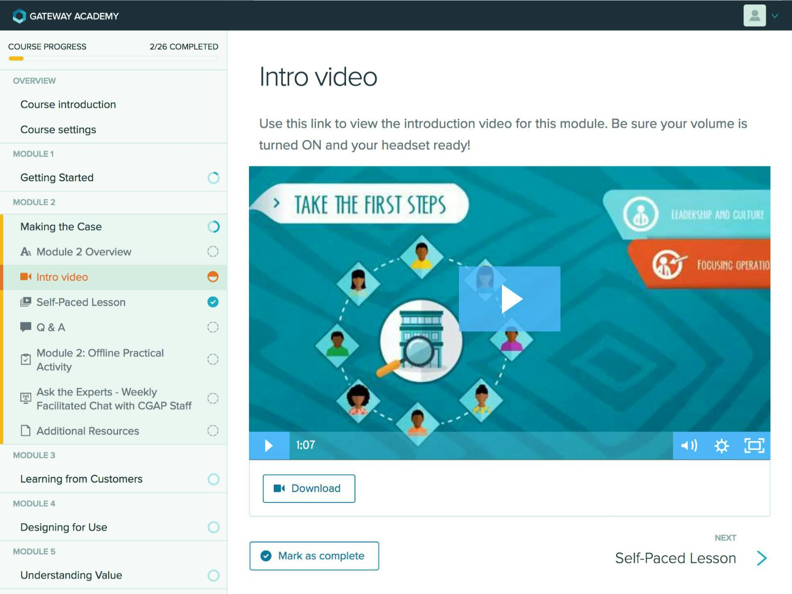
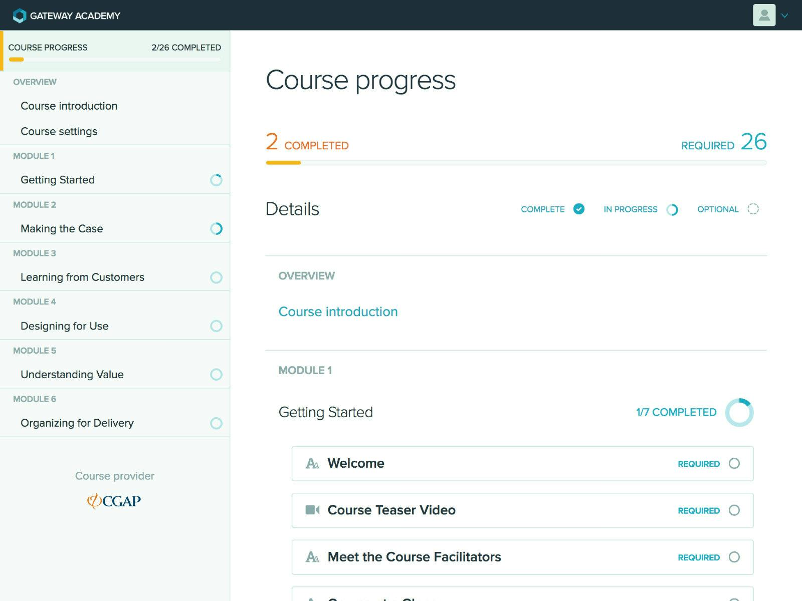
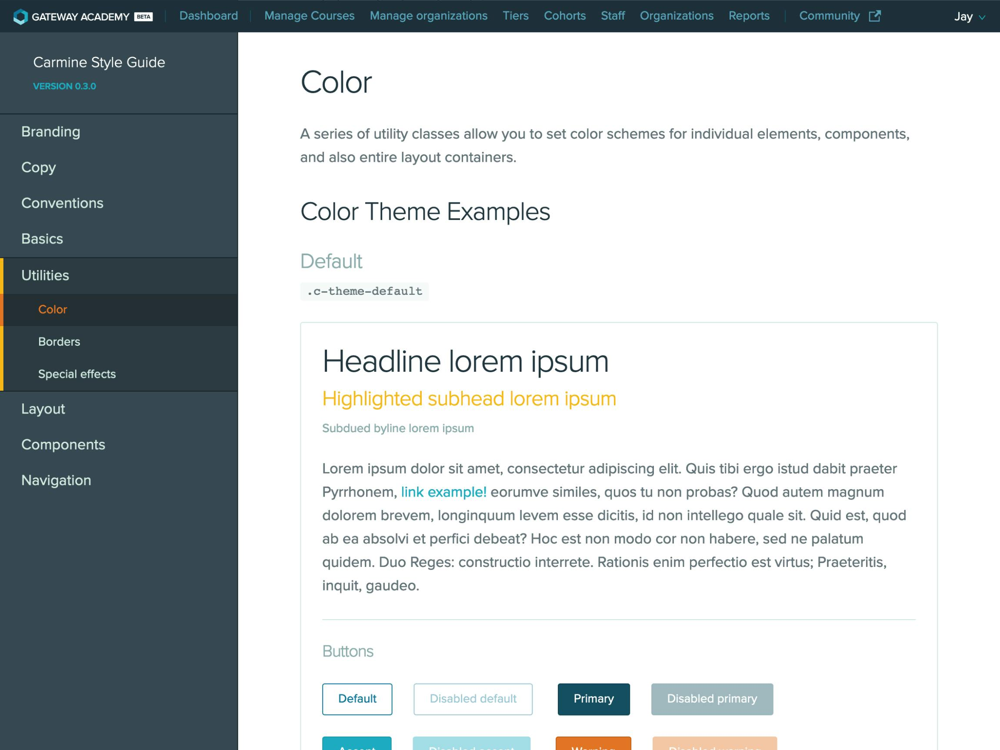
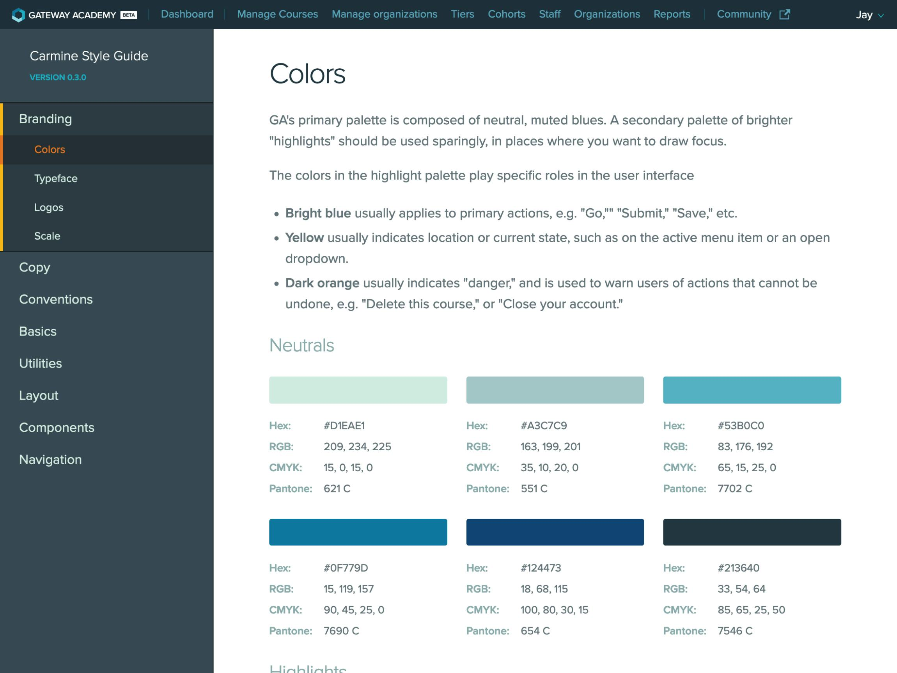
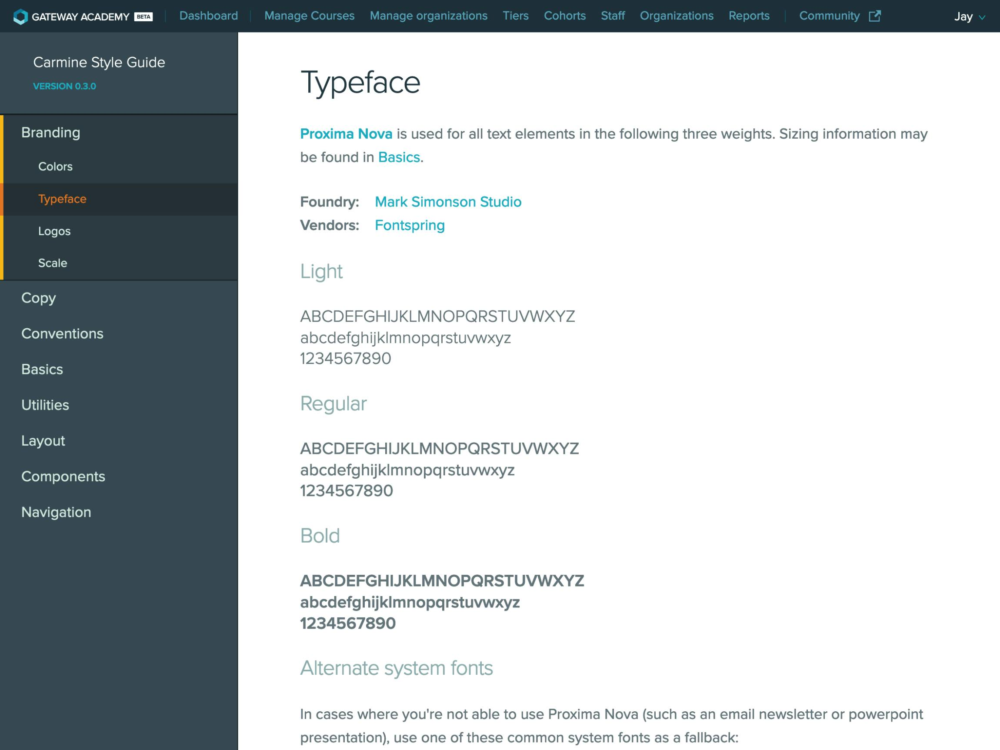
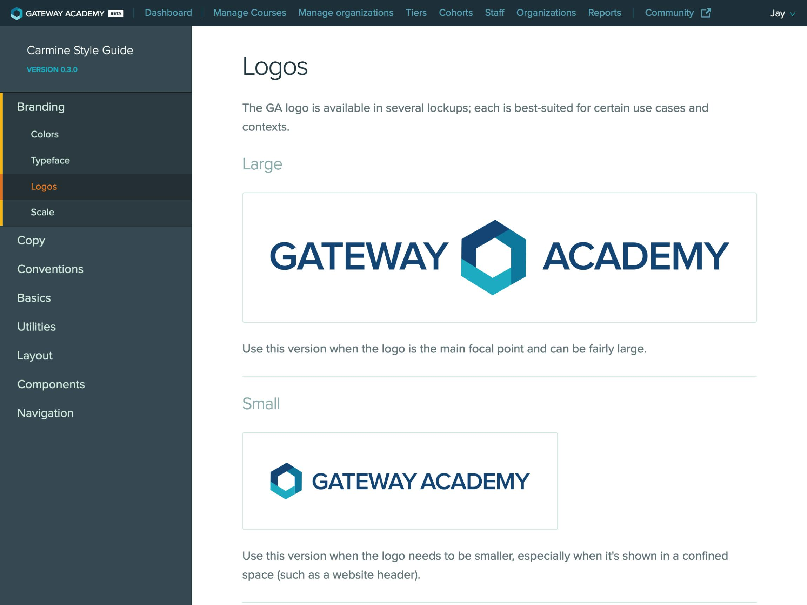

## A startup inside an NGO

Built in partnership with several other companies, Gateway Academy was a complex digital product developed over several years. Despite the NGO context and the number of stakeholders, our process and culture looked more like a small startup: rapid prototyping, agile development, and styleguide-driven design.

The platform took shape in a user workshop in Dar es Salaam, and was built mobile- and offline-first for learners on shared devices and patchy connections.

## From wireframes to a component library

Alpha prototyping began in early 2017 with content models and wireframe prototypes. Jay Perry’s design team then created a component library and styleguide so the development team could build coded prototypes, and evolved both in parallel with the branding and visual design.

## A styleguide-driven process

Over several years of continuous development, the team built a comprehensive styleguide documenting the brand, tone and voice, workflow, and an ever-evolving library of UI components.

In 2020 Gateway Academy merged into Digital Frontiers, carrying its content and learners forward.

