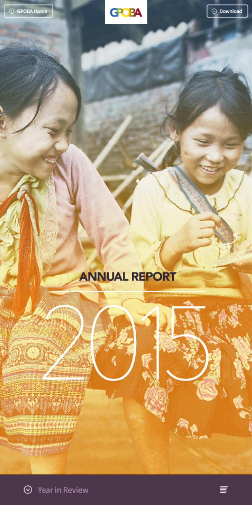
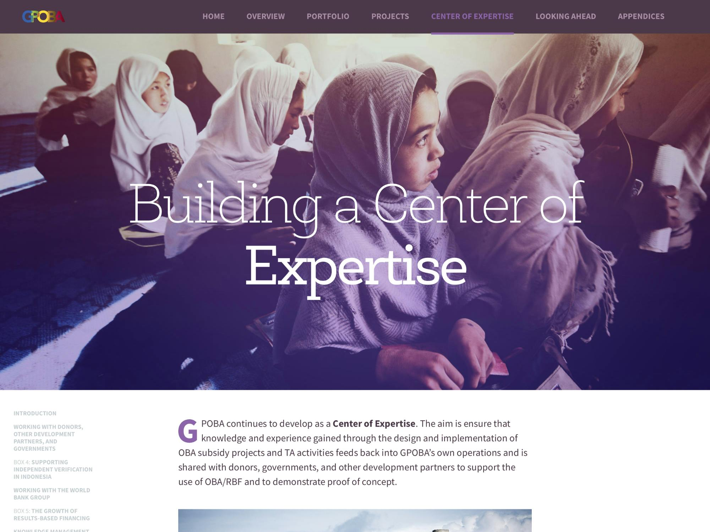
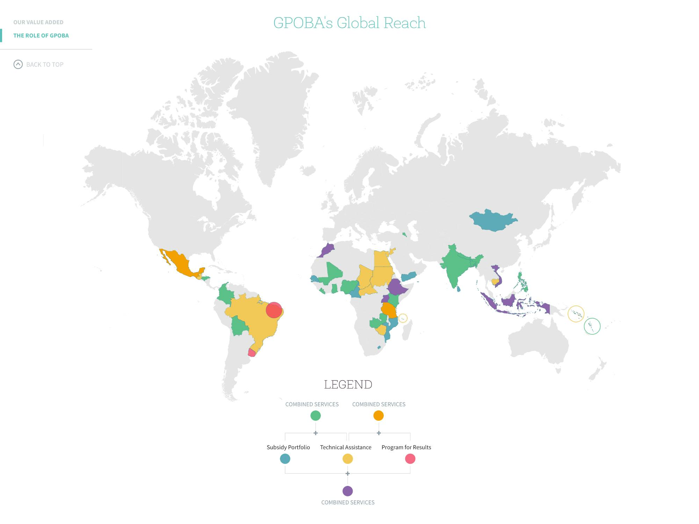
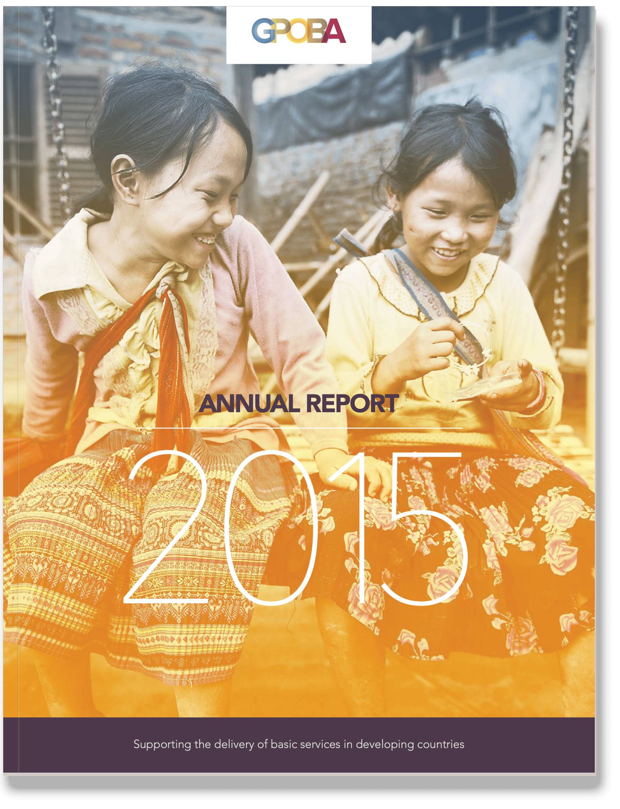
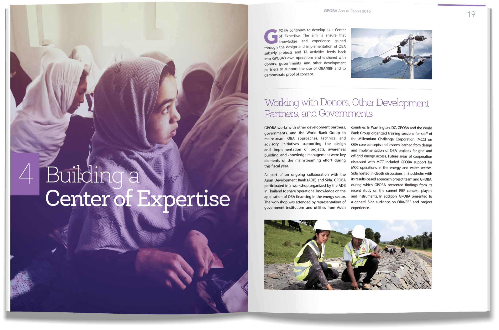
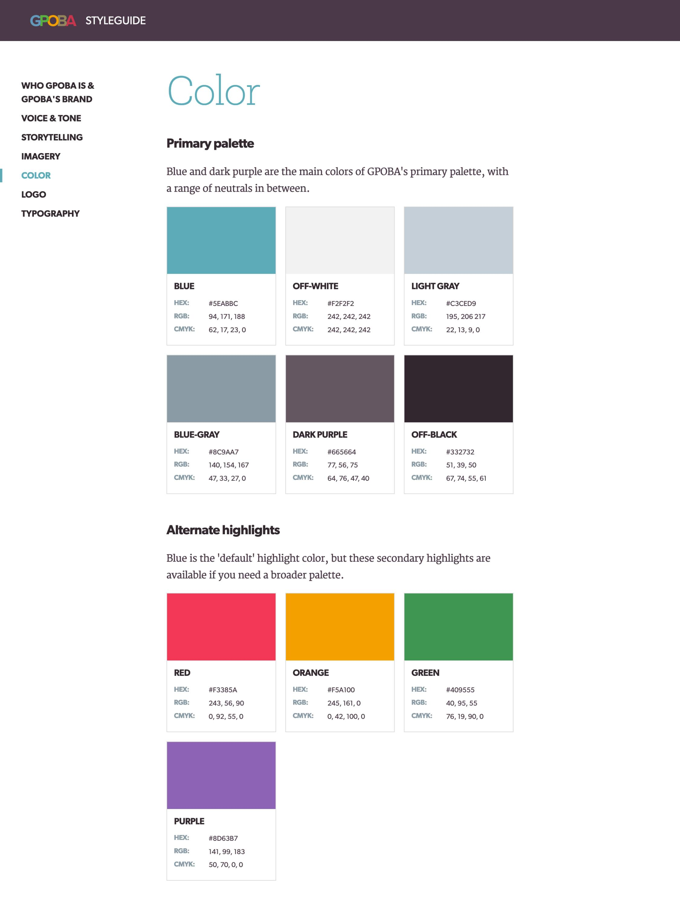
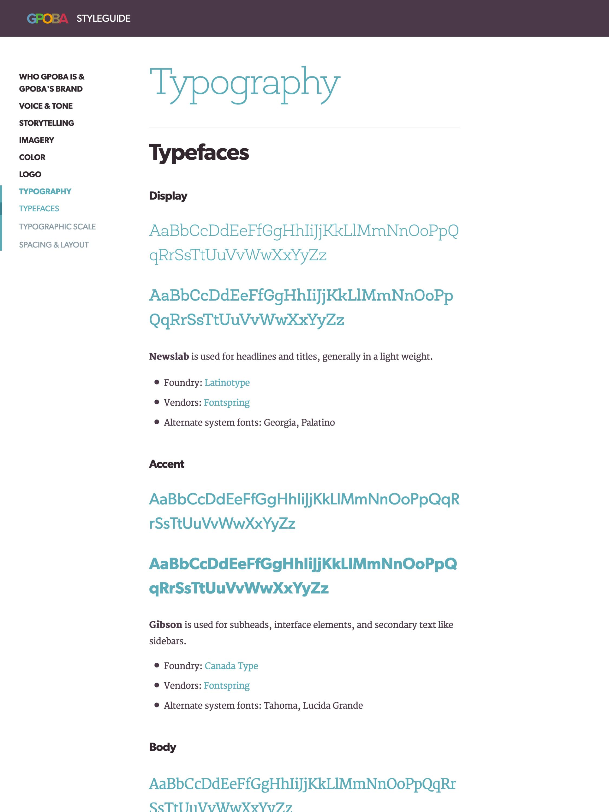

## A report on two platforms

GPOBA needed its annual report in print and online at the same time, on a tight budget and timeline, while the writing was still in progress.

Jay Perry developed a simple design language from GPOBA’s existing palette and the World Bank’s photo library, then adapted it for print and web while keeping a consistent feel.

## One source of truth

To give the team time to finish editing, we built a Git-based content workflow: markdown “master” text flowed into both the web and print templates and updated easily as changes came in.

## From report to brand system

GPOBA liked the report enough to ask us to document the design language for their other collateral. We researched their communications strategy, made recommendations, and produced an extensive online styleguide the team could keep developing.

We couldn’t change everything, including the logo, but documenting specific guidelines was a real step for a small team just starting to build an identity of its own.

