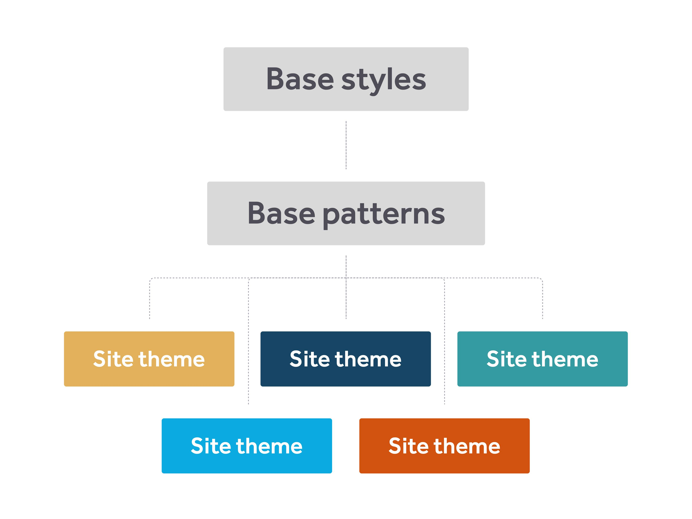
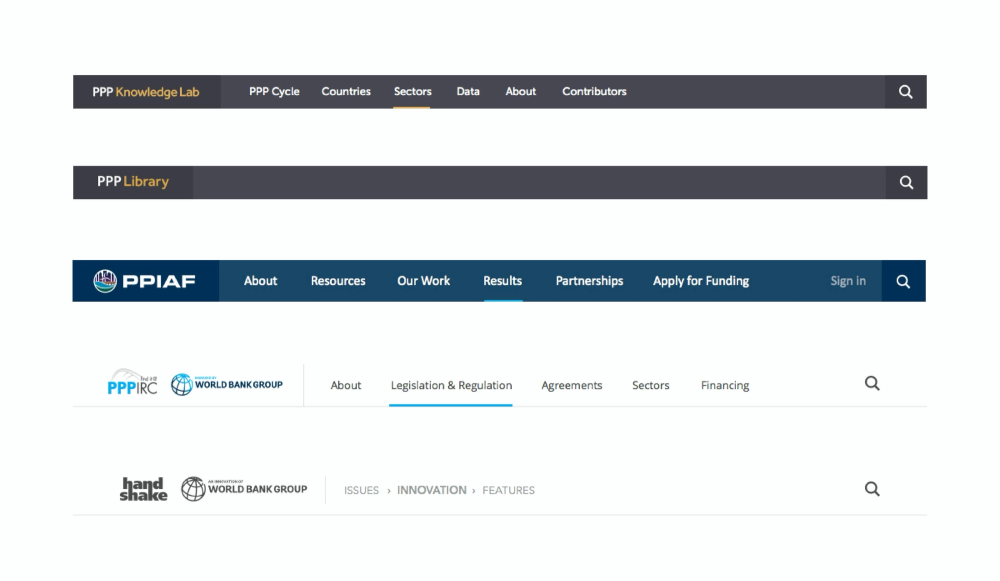
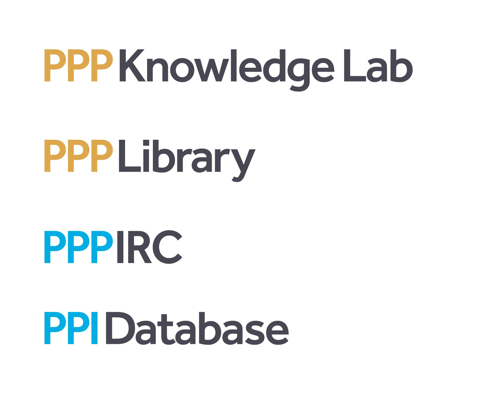
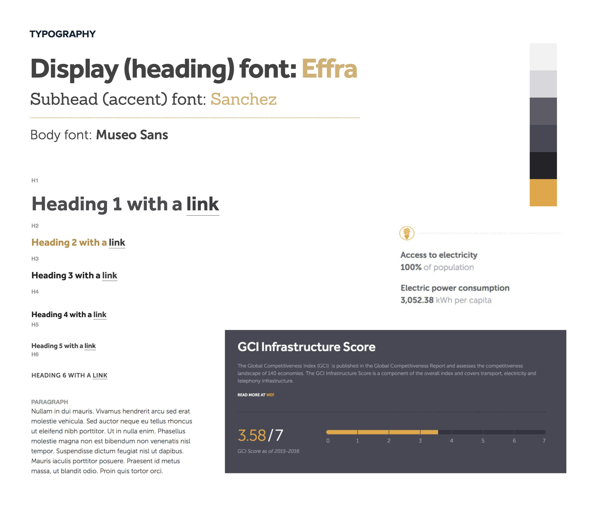

## The need

Public-private partnerships have become a popular model for designing and delivering infrastructure, but reliable information has been hard to find. The World Bank’s PPP group set out to build a comprehensive online knowledge bank with a number of other development agencies.

We interviewed practitioners, built use cases, wireframes, and prototypes, and tested the strategy at PPP Americas in Uruguay.

## One API, many sites

To manage scale across many stakeholders we built a services-based architecture: several million technical articles served by a central Rails REST API to a number of independent client sites.

## Theme-able by design

Jay Perry led design: branding, UX/UI, and front-end development. Base patterns like navigation and forms were shared across every site, while each site could override them with its own brand.

## Rollout

We launched at PPP Days in London with webinars, walkthroughs, and a joint communications plan. The Lab now lives within the PPP Legal Resource Center.
