## The challenge

GFDRR wanted its latest research in a striking, easy-to-digest booklet for the Sendai conference in Japan. The content was complex, and getting it down to length was the hardest part.

## Workshops first

We ran workshops with the authors at their offices to structure the content and find the most important messages. We moved things around, talked through flow, and scribbled and re-drew until it felt right.

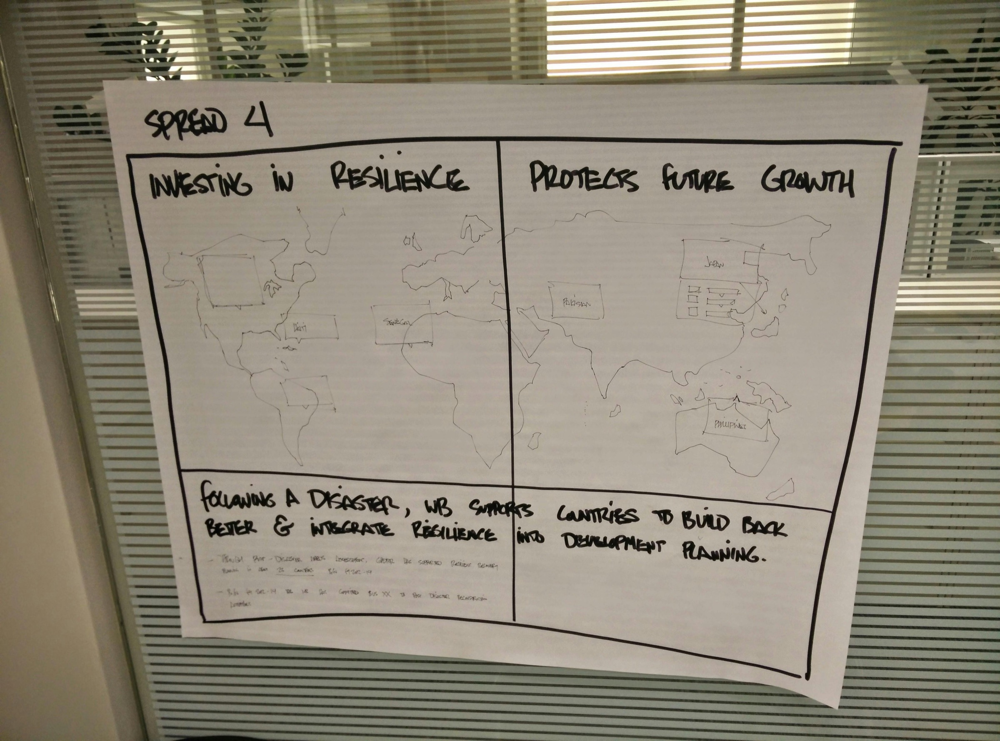
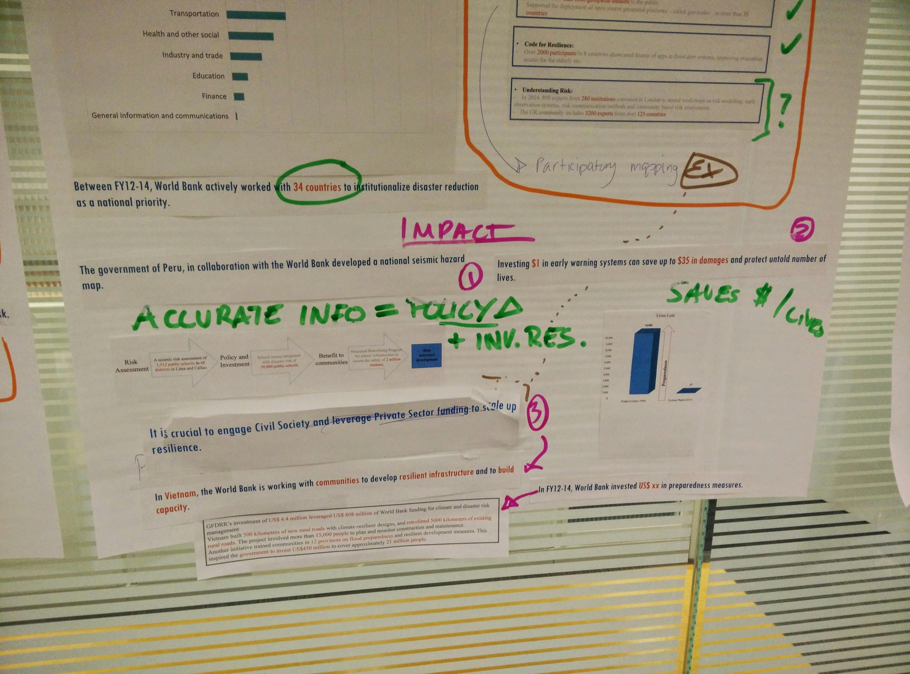
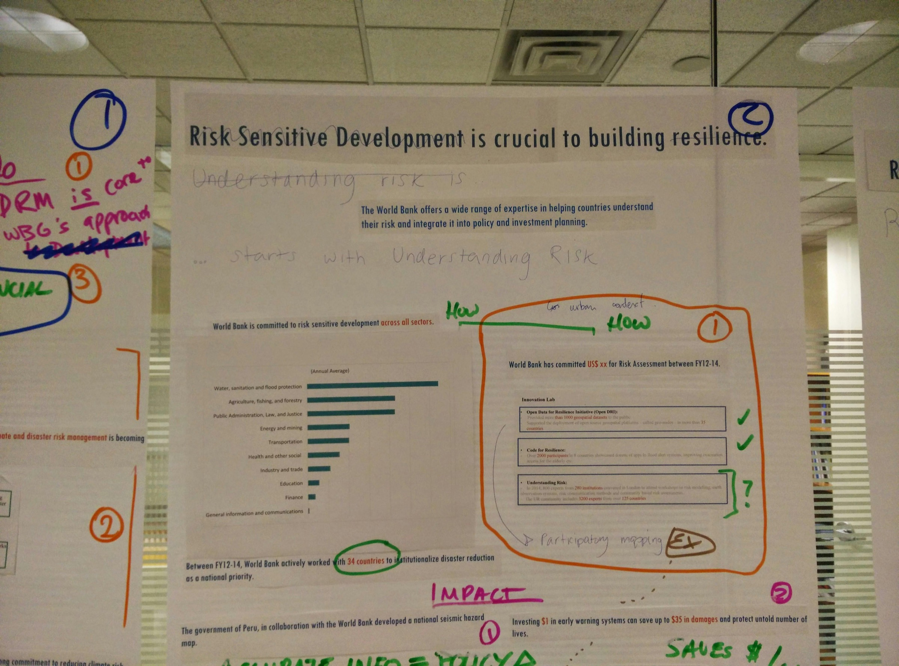
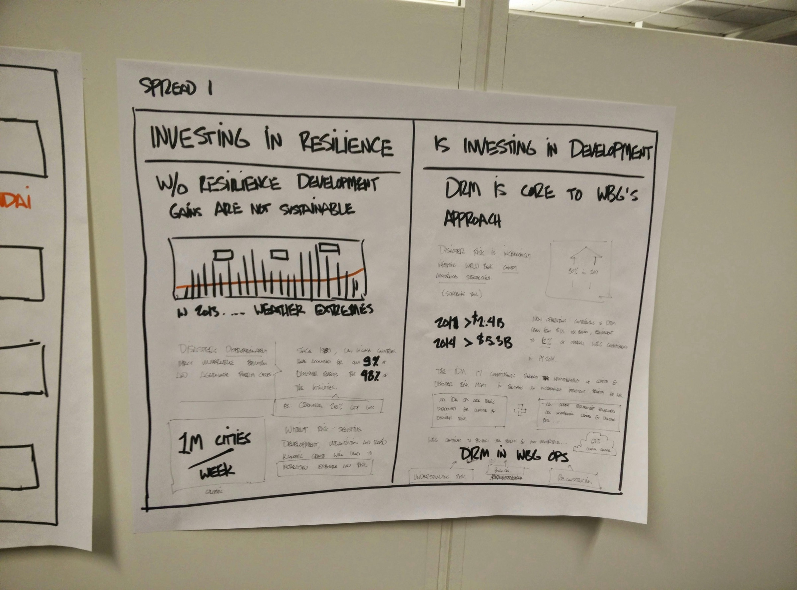

## Wireframing a book

We “wireframed” each spread to test flow and layout without getting stuck on color and graphics, settling on a roadmap: a visual path that leads the reader from one stop to the next. About five rounds of mockups came before final layouts.

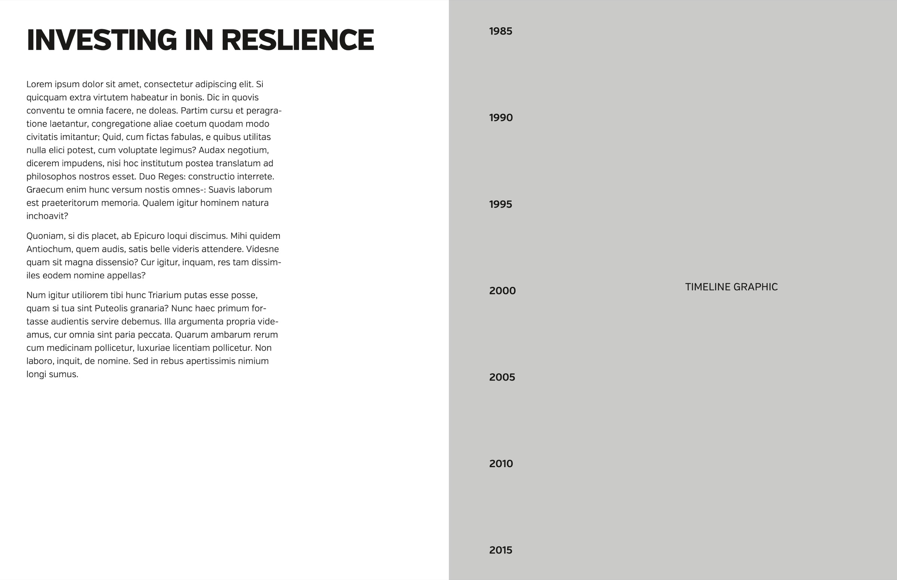
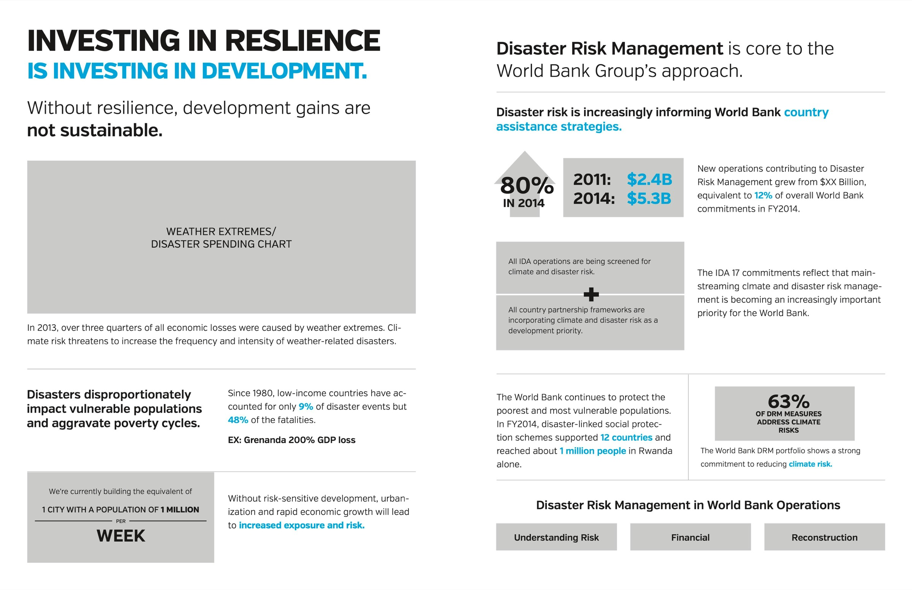
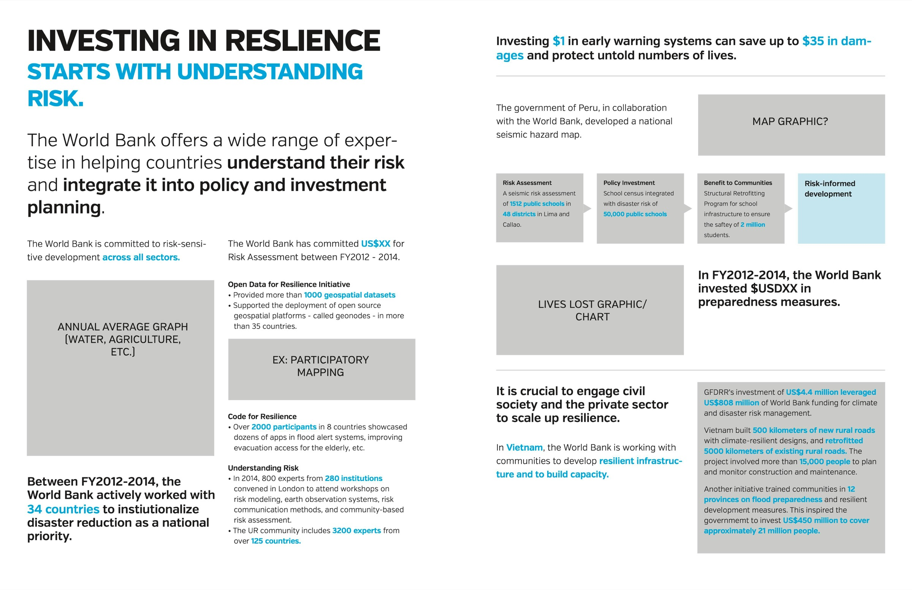
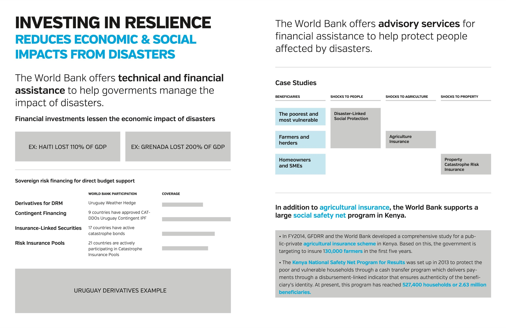

## Two hard weeks

With illustrator Alexandre Siqueira, the team developed the graphics, data visualizations, type, and color in two weeks to get the printed book to the conference on time.

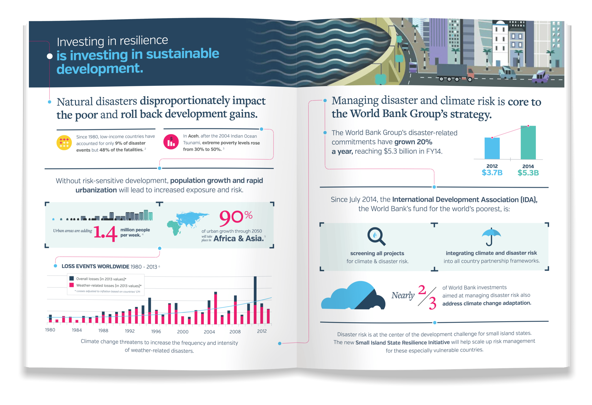
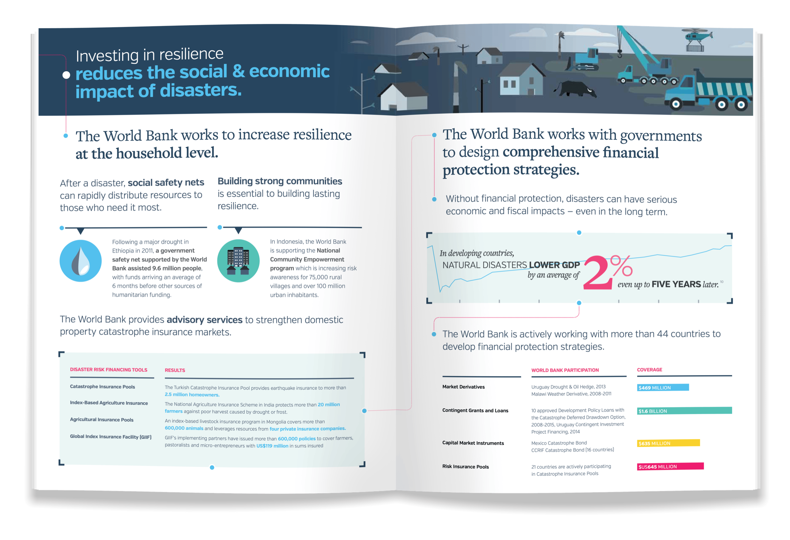
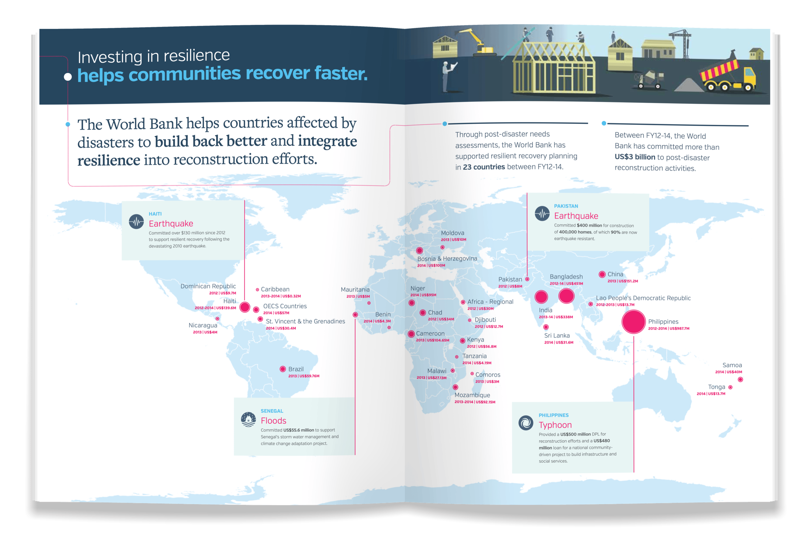
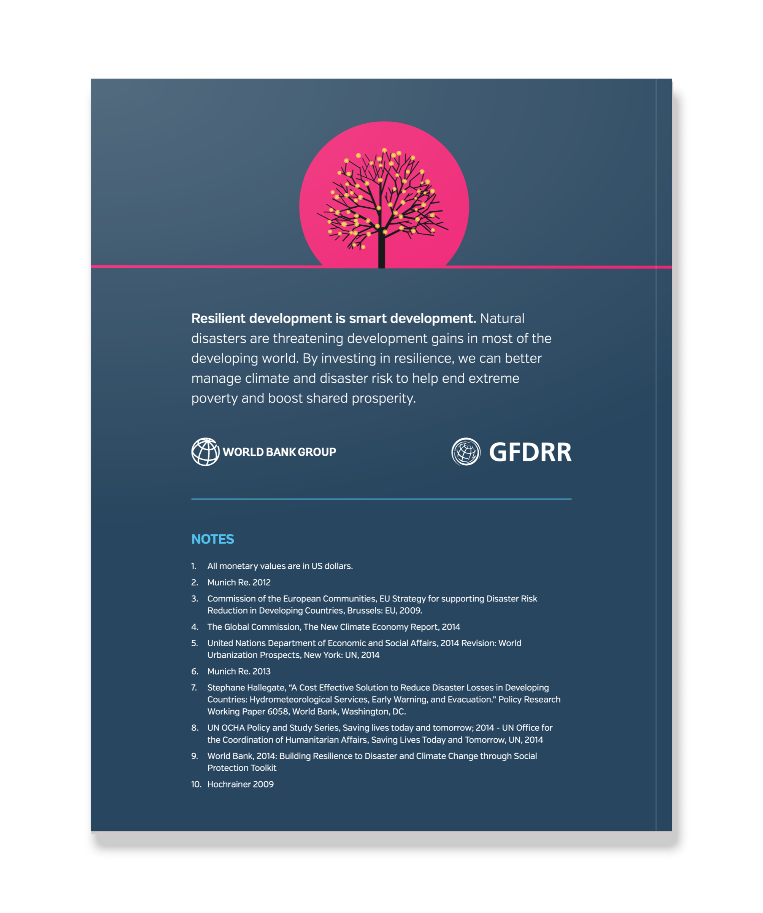
