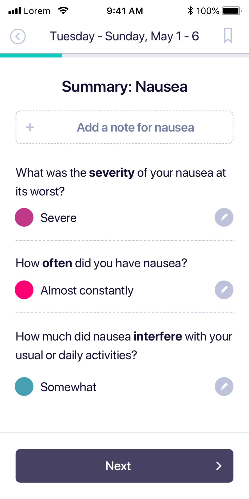
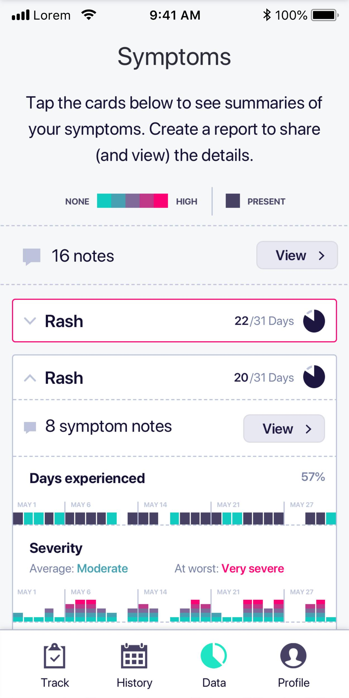

## Why we built it

In 2016 a member of our team, Christie, was diagnosed with breast cancer. After a year of intensive treatment she went into full remission, and we all breathed again.

Along the way, she struggled to manage her treatment. With ever-changing medications and therapies, waves of fatigue, and what she called “chemo brain,” it was hard to track side effects, and harder to give her care team accurate feedback.

## What it does

Christie led our effort to build Tela. Each day, users answer a short series of questions; the results can be exported and shared with their care team.

We hoped it would help patients like Christie manage their care and improve their quality of life.

